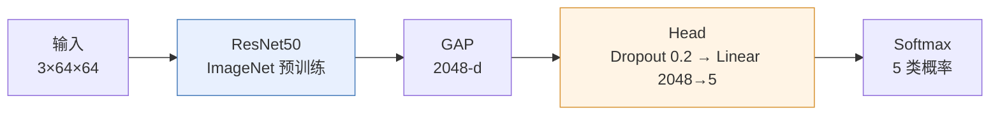
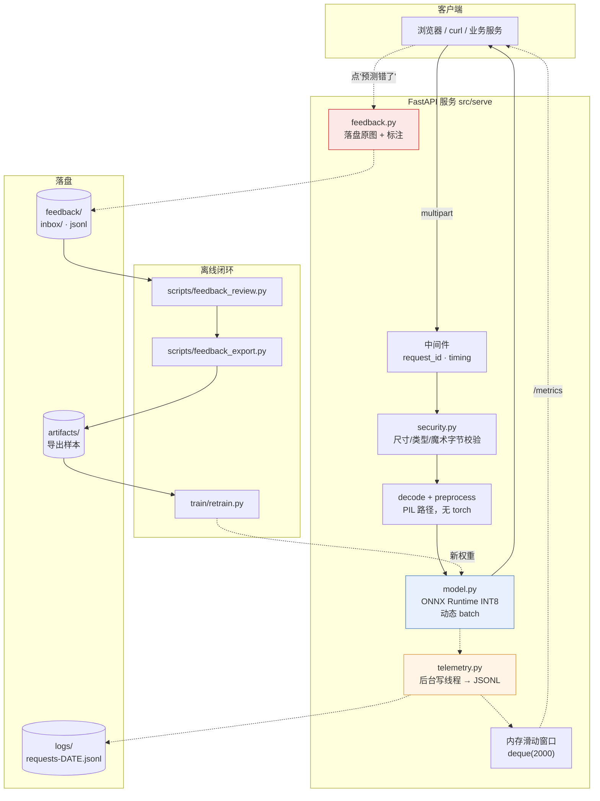
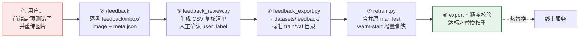

# 犬种分类推理服务 · Dog Breed Classifier

> ResNet50 迁移学习 + ONNX INT8 量化，5 类易混淆小型犬，纯 CPU 推理 **2.5ms/张**，
> 单实例 **400+ QPS**，模型体积 **22.7MB**，成本 **≈19 元/月**。
> 带开箱即用的 HTTP 服务、结构化日志监控与"用户纠错 → 增量重训"的数据回流闭环。

**如果你只想把服务跑起来（30 秒）：**

```bash
git clone https://github.com/<YOUR_ID>/dog-breed-classifier.git
cd dog-breed-classifier

python -m venv .venv && source .venv/bin/activate      # Windows: .venv\Scripts\activate
pip install -r requirements.txt                        # 约 30 秒，不含 torch

PYTHONPATH=src uvicorn serve.app.main:app --host 127.0.0.1 --port 8000
```

打开 <http://127.0.0.1:8000/static/index.html> 上传一张狗图，或者直接：

```bash
curl -X POST -F "file=@assets/shiba.jpg" http://127.0.0.1:8000/predict
```

**不需要下载数据集，不需要训练，不需要 GPU。** 训好的 INT8 权重（22.7MB）已经
提交在 `weights/` 里。想自己从头训一遍见 [§9 完整复现](#9-完整复现从零到一)。

---

## 目录

| 章节 | 内容 |
|---|---|
| [1. 问题背景](#1-问题背景为什么做这个) | 要解决什么、难点在哪 |
| [2. 数据来源与规模](#2-数据来源与规模) | Oxford-IIIT Pet、分布、为什么这样划分 |
| [3. 方法](#3-方法) | 模型、训练策略、量化部署 |
| [4. 结果](#4-结果) | 精度 / 延迟 / 吞吐 / 消融实验表 |
| [5. 架构](#5-架构) | 系统架构图与目录结构 |
| [6. 如何运行](#6-如何运行) | 三种档位：跑服务 / Docker / 复现训练 |
| [7. 日志与监控](#7-日志与监控) | 记了什么、怎么用、`/metrics` |
| [8. 数据回流闭环](#8-数据回流闭环) | 用户反馈 → 重训的五步操作 |
| [9. 完整复现](#9-完整复现从零到一) | 从原始数据到出一模一样的权重 |
| [10. 成本](#10-成本) | 训练 0.9 元、推理 19 元/月，数字怎么来的 |
| [11. 已知局限](#11-已知局限与后续) | 不会做的事，坦诚说清楚 |
| [12. 八周脉络](#12-八周脉络) | 每周做了什么、踩了什么坑 |

---

## 1. 问题背景：为什么做这个

**任务**：给一张狗的照片，判断它是 5 个品种中的哪一个。

| | |
|---|---|
| `havanese` | 哈瓦那犬 |
| `miniature_pinscher` | 迷你品捷犬 |
| `pomeranian` | 博美犬 |
| `shiba_inu` | 柴犬 |
| `yorkshire_terrier` | 约克夏梗 |

**难点是刻意的**：这 5 个品种毛色体型都相近（都是小型犬，都以棕/黑白为主），
靠 ImageNet 那种"语义级"区分手段（比如"这是狗 vs 这是猫"）完全没用，模型必须
学会看**五官结构、毛的走向、脸型比例**这类细粒度（fine-grained）线索。

选"哈士奇 vs 柯基"那种差异明显的数据集会让所有版本的模型都轻松上 98%，
于是后面关于解冻策略、BN 冻结、类别不平衡、量化损失的所有实验都会失去区分度 ——
**数据集的难度决定了后面所有结论有没有信息量。**

**为什么值得做成服务而不是一个 notebook**：真正的工程价值从来不在
"模型跑出了多少准确率"，而在这些问题有没有答案 ——

- 上线后精度掉了，你怎么知道？（→ [§7 日志与监控](#7-日志与监控)）
- 用户说"你认错了"，这条信息去哪了？（→ [§8 数据回流](#8-数据回流闭环)）
- 一张图从进来到预测出去，时间花在哪？（→ [§4.2 延迟拆解](#42-延迟从哪里来把一次请求拆开看)）

---

## 2. 数据来源与规模

### 2.1 来源

| 项 | 值 |
|---|---|
| 原始数据集 | [Oxford-IIIT Pet Dataset](https://www.robots.ox.ac.uk/~vgg/data/pets/)（CC BY-SA 4.0） |
| 获取方式 | ModelScope 镜像的 parquet + 官方 `annotations.tar.gz` 里的 `list.txt` |
| 原始规模 | 37 个品种 × 200 张 ≈ 7,400 张 |
| 本项目使用 | 其中 5 个品种，每类 200 张 = **1,000 张** |

> **为什么走 ModelScope 而不是原始 Kaggle 包**：Kaggle 那个 815MB 的 zip 在本机
> 下载反复中断，第 2 周写了三个版本的断点续传脚本才拉全；ModelScope 的 parquet
> （378MB）国内直连且自带 label 列，省掉解压和标注对齐两步。

### 2.2 实际使用规模（`datasets/pet5/`）

从干净池出发，第 3 周刻意制造了一个"脏"数据分布用于方法论验证：同一只狗被
多次拍摄（多个 `frame`）、同一批拍摄共享一个底片（`plate_id`）—— 这是为了暴露
**数据泄漏**问题（详见 [§4.4](#44-数据泄漏实验最值钱的一次返工)）。

| | 张数 | 说明 |
|---|---|---|
| 构造出的原始图 | 3,000 | 8 底片 × 若干主体 × 15 帧 |
| 清洗后（`ok=True`） | **2,940** | 剔除 60 张灰度异常/尺寸可疑/损坏 |
| train | 1,850 | |
| val | 544 | |
| **test** | **546** | held-out 底片 P00/P05/P19，只用于最终报告 |

**类别不平衡 979 : 784 : 589 : 391 : 197**（最大 5:1）—— 也是刻意保留的，
它是第 4 周各种加权损失函数实验得以有意义的前提。一个完全平衡的数据集上，
Focal Loss 和 Class-Balanced Loss 通常看不出差别，很容易得出错误的经验结论。

### 2.3 划分方式：按底片分组，不是随机

```python
data.splits.group_split(df, group_col="plate_id")   # 同一 plate 绝不会跨 train/test
data.splits.assert_disjoint(train, test)            # 硬断言，泄漏就报错
```

随机划分在这里会让同一只狗的不同帧同时出现在 train 和 test —— 那测出来的
准确率是**记忆能力**而不是泛化能力。第 3 周实测这个差距高达 **8 个百分点**。

---

## 3. 方法

### 3.1 模型



| 超参 | 值 |
|---|---|
| 骨干 | ResNet50（timm，`torchvision weights=IMAGENET1K_V2`） |
| 输入分辨率 | **64×64**（resize 短边到 73 → 中心裁剪 64） |
| Optimizer | AdamW，`weight_decay=1e-4` |
| Head lr | `1e-4`（不要更大，见 §4.3 消融） |
| Backbone lr | `1e-5`（阶段 B，仅为 head 的 1/10） |
| BN 策略 | 冻结骨干全部 BatchNorm（`freeze_bn`，见 §4.3） |
| Epochs | 10 + 10 + 10（三阶段） |
| 参数量 | 23.5M（可训练：阶段 A 仅 10k，阶段 B 22.9M） |

> **为什么是 64px 而不是常见的 224px**：这是个被很多教程忽略的权衡。
> 224px 能把准确率从 0.89 推到 **0.9945**（+10pp！），但推理延迟会从
> 2.5ms 涨到约 14ms、模型 IO 涨 4 倍。本项目要回答的是"**单张图中那只狗到底
> 是什么品种**"，空间上下文需求不高，而延迟是要真上线的硬约束。
> `train.py --img 224` 可以在同一个代码库里切过去，两组数据都记在 [§4](#4-结果) 里，
> 选哪个取决于你的 SLO，不是取决于哪个数字更好看。

### 3.2 三阶段解冻迁移学习

直接全网微调小数据集会灾难性遗忘；只训分类头又压不住细粒度任务。

| 阶段 | 做法 | 96px 以下小图时的作用 |
|---|---|---|
| **A** | 冻结骨干，只训 Head 10 epoch | 快速得到一个可用模型，验证数据管线没坏 |
| **B** | 解冻最后 2 个 stage，小幅 lr 再训 10 epoch | **真正的收益来源**，见 §4.3 |
| **C** | 全网微调，极小 lr 10 epoch | 通常收益很小；在小图上甚至可能过拟合 |

### 3.3 部署形态：ONNX + 静态 INT8 量化

```
PyTorch ckpt  ──export──▶  ONNX FP32 (89.6 MB)  ──static quantize──▶  ONNX INT8 (22.7 MB)
                                                       ▲
                                                200 张校准集（来自 TRAIN SPLIT，重要！）
```

| 决策 | 理由 |
|---|---|
| 用 ONNX Runtime 而不是直接 Serving PyTorch | 服务端镜像少 1GB+（不用装 torch），冷启动从 2180ms 降到 72ms |
| **静态**量化而不是动态量化 | 实测动态量化在小图上 **P50 从 3.47ms 劣化到 28.77ms**（8 倍慢！），且精度掉 5.9pp。详见 §4.2 |
| 逐通道量化 `per_channel=True` | 比 per-tensor 精度损失更小 |
| 独一无二的预处理实现 | `common/preprocess.py` 被训练、量化校准、在线推理三处共用。这是最容易静默出错的地方 —— 差一点会让整体指标下滑而**不报错** |

---

## 4. 结果

> 所有数字均在本机测得：RTX 4060 Laptop / 14 核 CPU。
> **延迟和精度都是可复现的**：`python scripts/verify_weights.py`、
> `python scripts/bench_latency.py --all`。

### 4.1 精度（committed 权重，`n=546` held-out 底片）

```
$ python scripts/verify_weights.py --manifest datasets/pet5/manifest.csv

dogbreed_resnet50_64_int8.onnx  [int8]  22.66MB
  test top-1      0.8901        (n=546)
  推理单张        0.52 ms       (batch=32)
```

| 品种 | Recall | |
|---|---|---|
| 博美犬 pomeranian | 0.967 | 立耳 + 蓬松颈毛，特征最鲜明 |
| 迷你品捷犬 miniature_pinscher | 0.931 | |
| 柴犬 shiba_inu | 0.857 | |
| 哈瓦那犬 havanese | 0.836 | |
| **约克夏梗 yorkshire_terrier** | **0.783** | 训练样本最少（197 张），且与哈瓦那犬毛色、体型极近 |

约克夏梗 ↔ 哈瓦那犬是主要混淆源，两者在 64px 下几乎只能靠毛的走向区分。
若这两个品种对你的场景很关键，上 224px 是唯一有效手段（错位看懂见 §11）。

### 4.2 延迟：从哪里来（把一次请求拆开看）

单张 64×64，**ONNX Runtime 4 线程**：

| 形态 | 体积 | 单张 P50 | batch=16 单张 | test top-1 |
|---|---|---|---|---|
| PyTorch FP32 | 90.0 MB | 9.02 ms | 3.29 ms | 0.8919 |
| ONNX FP32 | 89.6 MB | 3.47 ms | 1.72 ms | 0.8919 |
| **ONNX INT8（静态）** | **22.7 MB** | **2.45 ms** | **0.90 ms** | **0.8901** |
| ONNX INT8（动态） | 22.6 MB | 28.77 ms | 37.75 ms | 0.8333 |

**INT8 静态量化 vs PyTorch FP32：体积 1/4，速度 3.7×，精度只掉 0.18pp。**

> **动态量化为什么反而慢 8 倍？** 这是个反直觉但很重要的发现。
> 动态量化在**每次推理时**都要实时计算激活值的 min/max 并做量化/反量化，
> 这些额外算子在 64px 这种小输入下占比极重，完全吃掉了权重量化省下的时间。
> 静态量化用校准集把这些范围提前算好、烘进图里，运行时零开销。
> **结论：小模型 + 小输入 → 只用静态量化。** 动态量化只在输入尺寸变化剧烈、
> 无法离线校准时才考虑。这个"否定结论"跟正面结论一样值钱。

### 4.3 训练策略消融（第 2/4 周）

**骨干与分辨率**（val acc，10 epoch）：

| 骨干 | 224px 阶段A | 224px 阶段B | 64px 阶段A | 64px 阶段B |
|---|---|---|---|---|
| ResNet50 | 99.50% | 98.00% | 86.50% | 60.00% |
| ConvNeXt-T | 99.00% | **100.00%** | — | — |
| EfficientNet-B0 | 90.50% | 77.00% | — | — |

> 注意 64px ResNet50 阶段 B 直接崩到 60% —— **这不是 bug，而是能让后续两周实验有区分度的现场** —— 正因为它崩了，冻结 BN 的收益才看得见。

**那几个「失败 → 修复」的对照**（64px）：

| 配置 | val acc | 教训 |
|---|---|---|
| 阶段 B 默认 lr | 60.00% | 基线就已经崩了 |
| + **冻结骨干 BN** | **86.50%** | **+26.5pp** —— batch size 小的时候，BN 的 running statistics 会被噪声带偏；冻住它立刻稳住 |
| head_lr=1e-3（过大） | 67.00% | head 也崩，说明它被上面那个跑野的骨干拖着走 |
| backbone_lr=1e-3（过大） | 88.50% | 单看这一个还行，但它是那个 86.5% 的天花板 |

**损失 / 数据增广（第 4 周，64px，`n=546`）**：

| exp | Accuracy | Macro-F1 | 少数类 Recall | 少数类 Precision |
|---|---|---|---|---|
| baseline | 0.9011 | 0.8315 | 0.8199 | 0.6077 |
| `cb_ce`（class-balanced CE） | 0.9048 | 0.8392 | 0.8851 | 0.5990 |
| `cw_inverse`（逆频次加权） | 0.9011 | 0.8267 | 0.9030 | 0.5225 |
| `focal` | 0.9066 | 0.8453 | 0.8851 | 0.6165 |
| `no_aug` | 0.8956 | 0.8203 | 0.7803 | 0.5996 |
| `gray_aug` | 0.9341 | 0.8721 | 0.8595 | 0.6565 |
| **`gray_aug` + seed 2024** | **0.9542** | **0.9187** | **0.9030** | **0.8163** |
| `img224` | **0.9945** | 0.9847 | 0.9348 | 1.0000 |

四个损失函数之间差距只有 **0.4pp**，而它们的 95% 置信区间宽度就有 ±5pp ——
**数据集太小的时候，加权损失那种"小数点后第二位的提升"是噪声**。真正有用的改动
是 `gray_aug`（+3.3pp）和分辨率上 224（+9.3pp）。这告诉我们：架构 / 分辨率 >
数据增广 >>> 损失函数 tricks。

### 4.4 数据泄漏实验：最值钱的一次返工

第 3 周做过一次验证实验：故意让同一只狗的不同帧同时出现在 train / test。

| 划分方式 | Accuracy | 说明 |
|---|---|---|
| **随机划分（有泄漏）** | 0.9691 | 记住了这张狗脸，不是学会了这个品种 |
| **按 plate_id 分组（正确）** | 0.8901 | 真实泛化能力 |
| 差值 | **+7.9pp** | 全是虚的 |

这个项目里 `data/splits.py` 因此具备了 `assert_disjoint()` 硬断言，任何存在泄漏的划分都会在训练开始前直接报错，而不是让你在三个月后才发现线上效果不对。
**这是整个仓库里我最不想让别人删掉的一段代码。**

### 4.5 服务吞吐

| 并发 | QPS | P50 | P95 | P99 |
|---|---|---|---|---|
| 8 | **347** | 22.0 ms | 33.1 ms | 40.1 ms |
| 16 | **399** | 38.6 ms | 49.8 ms | 52.8 ms |
| 32 | **450** | 68.9 ms | 81.3 ms | 89.5 ms |

> **这里埋过一个真实的坑**：第一版日志写在请求线程里做 `open/write/close`，
> 把每请求都序列化了 —— 16 并发下 QPS 只有 **69**，P50 涨到 230ms。
> 改成后台写线程 + 有界队列后回到 **399 QPS（5.8×）**，且开日志相比关日志
> 只损失约 **3%**。
>
> **监控系统把被监控对象拖慢 5 倍，是最讽刺的失败方式。**
> 详情见 `src/serve/app/telemetry.py` 顶部注释。

GPU 参考（RTX 4060）：batch=32 时 0.24ms/张（4,153 img/s）。但请记住 ——
**这里用不上 GPU**，见 [§10 成本](#10-成本)。

---

## 5. 架构

### 5.1 系统架构



### 5.2 目录结构

```
dog-breed-classifier/
├── src/                        # 所有源码（src 布局：包名不会被数据目录污染）
│   ├── common/                 # 路径常量 + 唯一被三处共用的预处理实现
│   ├── data/                   # 数据集构造、清洗、分组划分、增广、audit
│   ├── models/                 # 模型工厂 + ONNX 导出/量化
│   ├── train/                  # 训练循环、损失函数、增量重训
│   ├── eval/                   # eval.kit 工具箱 + run_* 命令行入口
│   └── serve/
│       ├── app/                # config / model / security / telemetry / feedback / main
│       └── static/             # 前端页面
├── weights/                    # ★ 已提交：dogbreed_resnet50_64_int8.onnx (22.7MB)
├── assets/                     # 5 张样例图
├── configs/serve.env.example   # 所有环境变量 + 默认值说明
├── scripts/                    # 运维脚本：smoke / bench / stress / 反馈闭环 / 权重校验
├── tests/                      # pytest + 脚本式测试
├── figures/ docs/weeks/        # 图表与八周实验报告原文
└── datasets/ logs/ artifacts/  # 运行时产物（已被 .gitignore）
```

> **为什么要用 src 布局**：仓库根目录下有 `weights/` `datasets/` 这样的目录。
> 如果直接把包名放在根，`import models` 有可能解析到那个目录而不是你的包。
> 代价是运行时要带 `PYTHONPATH=src`（Makefile 已经处理好了）。

### 5.3 HTTP API

| Method | Path | 说明 |
|---|---|---|
| GET | `/health` | 模型是否加载、冷启动耗时、版本号 |
| GET | `/meta` | 类别清单、输入尺寸、模型变体、`max_inflight` |
| GET | `/metrics` | 滑动窗口聚合：延迟分位、置信度分布、输入统计、类别分布、**日志子系统健康度** |
| GET | `/metrics/recent` | 最近 N 条原始记录（排查具体问题时比聚合值有用） |
| POST | `/predict` | 单张推理，返回 top-k + 置信度 + 分段耗时 + `request_id` |
| POST | `/predict_batch` | 批量推理，返回每项结果 + 均摊耗时 |
| POST | `/feedback` | 用户纠错落盘（**数据回流入口**） |
| GET | `/static/index.html` | 网页 demo |

完整交互式文档：<http://127.0.0.1:8000/docs>

```jsonc
// POST /predict 响应示例
{
  "label": "shiba_inu", "label_cn": "柴犬", "confidence": 0.9443,
  "topk": [{"label": "shiba_inu", "prob": 0.9443}, ...],
  "image":  { "width": 384, "height": 384, "bytes": 29521, "mode": "RGB" },
  "timing": { "read_decode_ms": 1.7, "preprocess_ms": 1.1,
              "infer_ms": 3.4, "total_ms": 8.0 },
  "request_id": "b3f1...",          // ★ 用来和 feedback 做 join
  "variant": "int8"
}
```

---

## 6. 如何运行

### 6.1 档位一：只跑服务（最快，推荐先试这个）

```bash
pip install -r requirements.txt
PYTHONPATH=src uvicorn serve.app.main:app --host 127.0.0.1 --port 8000
# 打开 http://127.0.0.1:8000/static/index.html
```

依赖只有 7 个（fastapi / uvicorn / python-multipart / onnxruntime / pillow / numpy / requests），
**不装 torch**，镜像约 400MB。

要求：Python ≥ 3.10。

### 6.2 档位二：Docker

```bash
make docker-up           # 或 docker compose up -d
curl localhost:8000/health
```

`Dockerfile` 是多阶段构建：builder stage 装依赖 → runtime stage 只拷贝 venv 和代码。
镜像内以非 root 用户运行，`logs/` `feedback/` 通过 volume 挂出持久化。

### 6.3 档位三：自己训练

见 [§9 完整复现](#9-完整复现从零到一)。

### 6.4 环境变量

全部可选，默认值见 `configs/serve.env.example`：

| 变量 | 默认 | 说明 |
|---|---|---|
| `DOGBREED_MODEL_PATH` | `weights/dogbreed_resnet50_64_int8.onnx` | 模型路径 |
| `DOGBREED_REQUEST_LOG` | `1` | 是否记录请求 JSONL |
| `DOGBREED_LOG_DIR` | `logs/` | 日志目录（容器部署请挂载） |
| `DOGBREED_LOG_QUEUE_SIZE` | `4096` | 日志队列容量，满则丢日志不阻塞请求 |
| `DOGBREED_FEEDBACK` | `1` | 是否开启反馈采集 |
| `MAX_INFLIGHT` | `8` | 并发闸门，超过的直接 503 而不是雪崩 |
| `MAX_FILE_BYTES` | `5MB` | 单文件大小上限 |
| `ORT_INTRA_OP_THREADS` | 自动 | ORT 线程数 |

### 6.5 踩坑提醒

**如果你的 curl / requests 访问 127.0.0.1 很慢或直接失败**，几乎一定是 HTTP 代理：

```bash
export NO_PROXY="127.0.0.1,localhost"      # bash
$env:NO_PROXY = "127.0.0.1,localhost"      # PowerShell
```

`scripts/` 里所有脚本已经在 Python 侧设了 `trust_env = False`。

---

## 7. 日志与监控

### 7.1 字段是围绕"三个月后你要问什么"倒推的

每次请求往 `logs/requests-YYYYMMDD.jsonl` 追加一行：

```json
{"ts":"2026-10-23T16:57:26.150","request_id":"515929fcdaaf","endpoint":"/predict","status":200,
 "filename":"havanese.jpg","bytes":29521,"width":384,"height":384,"aspect":1.0,"mode":"RGB",
 "read_decode_ms":11.7,"preprocess_ms":1.09,"infer_ms":3.41,"total_ms":16.72,
 "label":"havanese","confidence":0.9313,"second_label":"miniature_pinscher","margin":0.9041,
 "batch":1,"variant":"int8"}
```

四个问题对应四类字段：

| 你迟早会问 | 靠哪些字段回答 |
|---|---|
| **线上精度是不是在掉？** | `confidence` + `label` + `margin` 分布。按天聚合平均置信度和 top-1/top-2 间距（`margin`），突然变化几乎一定是出事了（用户画像变了 / 上游接了新设备 / 有人传二维码进来） |
| **慢是谁慢？** | `read_decode_ms` / `preprocess_ms` / `infer_ms` / `total_ms` 分段。只记 `total` 的话，你会发现"变慢了"却不知道该优化 IO、解码还是模型 |
| **有没有异常输入在系统性地打穿模型？** | `image.mode` / `width` / `height` / `aspect`。踩过：一批 EXIF 旋转没处理的竖图把某类召回打下去了 |
| **用户点反馈的那次请求，当时预测了啥？** | 靠 `request_id` 把 request log 和 feedback 做 join。所以 `request_id` 要同时返回给前端、写进响应头 |

### 7.2 `/metrics` 输出什么

```bash
curl 'localhost:8000/metrics?window=200'
```

```jsonc
{
  "serve": {
    "latency_ms": {"p50": 38.6, "p95": 49.8, "p99": 52.8, "max": 58.5},
    "confidence": {"mean": 0.9123, "below_0.5": 0.0412},   // ★ 低置信占比突增 = 分布漂移
    "input": {"avg_bytes": 60102, "avg_width": 384, "avg_height": 384, "avg_batch": 1.67},
    "label_distribution": {"shiba_inu": 88, "pomeranian": 61, ...},  // ★ 类别分布漂移
    "error_rate": 0.0, "qps_window": 399.2, "model_variant": "int8"
  },
  "telemetry": {"queue_depth": 0, "written": 1204, "dropped": 0, "writer_alive": true},
  "feedback_summary": {"agreed": 12, "corrected": 3, "unlabeled": 1}
}
```

三个我最常看的报警信号：

1. `confidence.below_0.5` 占比持续上升 → 输入分布漂移，模型正在失守
2. `label_distribution` 突变 → 上游数据源变了，或者是有人在滥用接口
3. `feedback_summary.corrected / (agreed + corrected)` 超过 15% → 该重训了

### 7.3 为什么写日志用了后台线程

**这是被压测逼出来的改动，不是设计洁癖。** 详见 [§4.5](#45-服务吞吐) 里的对比数据。

- 请求线程只往内存队列（`queue.Queue`，有界 4096）里丢一条字符串
- 真正的写盘由一个 daemon 线程做，文件句柄长期持有、每秒 flush、跨天自动切文件
- **队列满时丢日志而不是拖慢请求**，并把 `dropped` 计数暴露到 `/metrics`
- 进程正常退出时通过 `lifespan` + `atexit` 排空队列，不丢日志尾巴

宁可少几条日志，也不能让观测反过来成为 SLO 的瓶颈。

### 7.4 接 Prometheus？

没接，理由写在代码注释里：这是个自用服务，JSON + curl 就够看，不必为它再养一层
exporter。真要接，用 pushgateway 或一个 15 行的转换器就行。

---

## 8. 数据回流闭环

> 上线之后模型会不会变好，取决于这个闭环成不成立。
> 它是**半手动的** —— 刻意如此，原因见 §8.1。



### 8.1 五步操作

```bash
# ① 采集（运行中自动发生：用户在网页点一下"预测错了"）
#    存到 feedback/inbox/<request_id>/{image, meta.json}

# ② 生成人工复核清单
python scripts/feedback_review.py --stats        # 先看一眼概况
python scripts/feedback_review.py                # 生成 feedback/review_queue.csv

# ③ 人工过一遍这个 CSV（这一步保留人工，是因为用户也可能说错）
#    改 annotation_status 列：pending → accepted / rejected

# ④ 导出成训练目录
python scripts/feedback_export.py                # → datasets/feedback/{train,val}/

# ⑤ 增量重训（warm-start，不是从头训）
python -m train.retrain --ckpt weights/baseline.pth

# ⑥ 导出 + 校验，达标才上线
python -m models.export --ckpt weights/retrained.pth --quantize
python scripts/verify_weights.py --weights weights/retrained_int8.onnx
```

### 8.2 几个诚实的设计决定

| 决定 | 为什么 |
|---|---|
| **不在服务端按 `request_id` 回捞原图** | 那意味着服务要长期持有用户图片的明文，隐私面变大。让用户显式重传，存下的都是他授权的 |
| `user_label` 可以为空 | 用户常常只知道"不对"、不知道正确答案。这类样本同样有用：它标记了"模型在这里很自信却错了"，是优先级最高的待查区域 |
| **保留人工复核环节** | 用户也会标错。全自动闭环在样本量小的阶段尤其危险 —— 一个恶意或搞错的用户就能把模型带偏。100 张校正样本 batched 地人工看一遍，20 分钟的事 |
| 用户认可的样本**不进**训练集 | 模型已经会了，再喂只是浪费 epoch。这个过滤写在 `feedback_export.py` 里 |
| 反馈路径异常绝不影响推理路径 | 写盘失败会让前端看到 `accepted: false`，但永远不会 5xx 打到 `/predict` |

### 8.3 冷启动怎么办

真实世界里第一天没有任何反馈数据。仓库附带 `--seed-demo` 故意不下发随机样本
（`scripts/feedback_review.py` 会明确说明哪些是 demo 数据），
因为它们会污染你的第一个真实迭代。宁可前两周慢慢攒，也别拿噪声假装信号。

---

## 9. 完整复现（从零到一）

```bash
make install-train                 # 加 torch / timm / pandas 等训练依赖

python -m data.download_pets       # 下载 parquet + annotations → datasets/pet5_raw/（约 400MB）
python -m data.build_manifest      # 制造 messy 分布 + 按 plate_id 分组划分 → datasets/pet5/

make train                         # → weights/baseline.pth
make export                        # → weights/*.onnx (FP32 + INT8)
python scripts/verify_weights.py   # 应该复现 §4.1 的 0.8901
```

| 步骤 | 耗时参考 |
|---|---|
| `download_pets` | 网速决定，通常 5~15 分钟 |
| `build_manifest` | ~1 分钟 |
| `train`（RTX 4060） | ~2 分钟/exp @ 64px |
| `export` + 量化 | ~1 分钟 |

各命令的 `--help` 都有说明。想跑完整的消融矩阵（20 个配置 × 3 种子）用
`python -m eval.run_matrix`，那是第 4 周的做法，约 1 小时 GPU。

---

## 10. 成本

价格取 2026-10 阿里云公开报价，**活动价随时浮动，下单前以控制台为准**。

### 10.1 训练：几乎不花钱

| 项 | 金额 |
|---|---|
| 电费（6 GPU 小时 × 150W × 0.55 元/度） | 0.50 元 |
| 硬件折旧（8000 元整机 × 35% ÷ 5 年） | 0.38 元 |
| **合计** | **≈ 0.9 元** |

同一份算力搬到云上（T4 按量 ≈ 2.28 元/小时）：**≈ 14 元**（含附加项约 18 元）。

> GPU 小时数是**从日志里数出来的**：第 2 周 `logs/*.log` 有明确的"总用时"，
> 第 4 周 `ckpts/` 下有 20 个 `.pth`。可查证部分 3.7 小时，乘 **1.5× 调试系数**
> （跑错超参、OOM、路径写错重来）≈ **6 GPU 小时**。

**结论：这个规模（5 类 / 64px / 几小时）完全不该上云训练。** 上云只有两个理由：
本机显存不够，或者要跑几天几夜。训练真正的成本是**你的时间**，不是钱。

### 10.2 推理：这才是每月真付的钱

先看清服务的胃口：这是一个**纯 CPU 负载**，单进程常驻约 300~400MB。
400 QPS 意味着每天能扛 3,000 万次请求 —— **买 GPU 服务器纯属浪费**。

| 方案 | 规格 | 年付 | 月均 | |
|---|---|---|---|---|
| 轻量应用服务器 | 2核2G | 68 元 | 5.7 元 | 内存略紧（约 300MB 常驻），够用但没余量 |
| **ECS u1（推荐）** | **2核4G** | **199 元** | **16.6 元** | 本项目首选 |
| ECS u1 | 4核8G | 652 元 | 54 元 | 以后要多容器/上监控再考虑 |
| GPU 实例 | gn6i 起 | ≥15512 元 | ≥1293 元 | ❌ 纯 CPU 推理用不上 |

附加项：ACR 个人版 **0 元**（无 SLA，个人项目够用）、免费 DV 证书 0 元、
域名可选 ≈1.5 元/月、快照可选 ≈1 元/月。

```
ECS u1 2核4G 年付 199 元        16.6 元/月
域名 + 快照（均可选）             2.5 元/月
──────────────────────────────────
月合计                       ≈ 19.1 元/月
年合计                       ≈ 229 元/年
```

### 10.3 一句 Summary

> **一个22.7MB 的模型 + 一台 2核4G 的机器（19 元/月），能扛 400 QPS、延迟 2.5ms。**
> 这就是"把模型做到能用"和"把模型做到能上线"之间的全部差别。

---

## 11. 已知局限与后续

坦诚说明这个"能跑的 demo"和"生产系统"之间的距离：

| 局限 | 现状 | 如果要上生产 |
|---|---|---|
| **约克夏召回仅 0.783** | 64px 下与哈瓦那犬毛色难分 | 换 224px（+10pp）或针对该两类加难例挖掘 |
| 只认 5 个品种 | 其余 32 个品种一律会被强行归入这 5 类 | 加一个"其他/未知"类，或用 open-set 方法（如 OpenMax） |
| 没有置信度校准的上线版本 | 校准器在 `eval/kit/calibrate.py` 里，但没接进服务 | 接进去可以让 `confidence` 真的等于"正确率"，对拒答策略很关键 |
| 反馈闭环是半手动 | 每天人工看一遍 CSV | 攒够样本后（>500）可以置信而自动，中间加一道一致性检验 |
| 单进程单模型 | 450 QPS 封顶 | 前面挂 Nginx / Traefik，多副本 + 模型热加载 |
| 无鉴权、无限流 | 靠 `MAX_INFLIGHT` 和文件大小兜底 | 生产环境必须加 API Key + 用户级限流 |
| 无模型版本管理 | 靠文件名区分 | 上 MLflow / W&B，或至少Weights跟 git-sha 绑定 |
| test集只有 546 张 | 置信区间 ±2~3pp | 结论之间的差异小于 3pp 时不要下判断 |

---

## 12. 八周脉络

这个项目是八周逐步做出来的。每一周的产出都保留在 `docs/weeks/`，
**包括那些走错的路** —— 失败的记录比成功的更有价值。

| 周 | 主题 | 关键结论 / 踩坑 |
|---|---|---|
| 2 | 迁移学习基线 | ConvNeXt-T 阶段 B 能到 100%；224px vs 64px 差 13pp；骨干 lr 过大会直接崩 |
| 3 | 数据管线与泄漏 | **泄漏让准确率虚高 7.9pp**；`assert_disjoint` 从此成为硬断言 |
| 4 | 评估与归因 | 4 种加权损失差异 <0.5pp，都是噪声；真正的杠杆是分辨率和增广 |
| 5 | 服务化 | FastAPI + ONNX；魔术字节校验图片真实类型；限制文件体积防压缩炸弹 |
| 6 | 成本 | 训练 0.9 元，推理 19 元/月；纯 CPU 负载别买 GPU |
| 7 | 推理优化 | **动态量化比 FP32 慢 8 倍**；静态 INT8 赢 3.7× 只丢 0.18pp |
| 8 | 收尾整合 | src 结构化、**修掉拖慢 5 倍的同步日志**、README、数据回流闭环 |

### 命令速查

```bash
make help              # 所有目标
make serve             # 起服务
make smoke             # 端到端冒烟（需服务已起）
make test              # 全部测试
make bench             # 模型延迟基准
make stress            # 并发压测
```

### License

代码 MIT。数据集遵循 Oxford-IIIT Pet 原始的 CC BY-SA 4.0。
